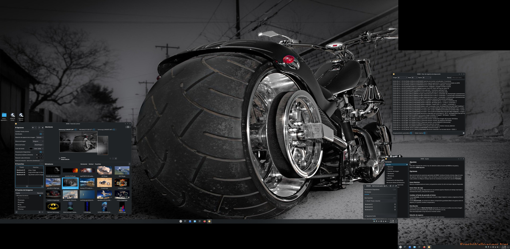

<!--
SPDX-FileCopyrightText: 2026 makimanson
SPDX-License-Identifier: GPL-3.0-or-later

WMM - Wallpaper Multi-Monitor Manager

README.md -- README file in English

WMM-Title: Readme
WMM-Contents: Contents
-->

# WMM - Wallpaper Multi-Monitor Manager

A wallpaper manager for multi-monitor setups on **Cinnamon**, **GNOME Shell**, **KDE Plasma 6** and **MATE**.
Forget stretched, cropped or repeated wallpapers.
With WMM, you're in full control.

<p align="center">
  <a href="wmm/screenshots/screenshot.jpg">
    
  </a>
</p>

## ✨ Main features

*   **True multi-monitor management**: Assign different wallpapers to each monitor or stretch (`Spanned`) a panoramic image across all of them.
*   **Smart image assignment**: Tries to pick the most suitable image for each monitor based on portrait or landscape orientation.
*   **Flexible aspect modes**: Control how images fit: `Scaled` (no distortion), `Zoom` (fill by cropping) or `Stretched` (fill by stretching).
*   **Visual effects**: Apply `Sepia` or `Black & White` filters per monitor.
*   **Background effects**: Apply `Blur` or `Color` to background area when an image does not cover the whole monitor.
*   **Automatic rotation**: Set a timer to change wallpapers synchronously (`SYNC`) or asynchronously (`ASYNC`).
*   **Spanned mode**: Build one logical image across all monitors while respecting position and geometry.
*   **Favorites**: Save individual images and complete wallpaper combinations as Presets for quick reuse.
*   **Control Panel**: Manage sources, monitors, favorites, effects, thumbnails and options from one common interface across supported desktops.
*   **Desktop integration**: Native applets for Cinnamon and MATE, GNOME Shell extension and KDE Plasma 6 plasmoid.
*   **Native file manager integration**: Select an image to add it to favorites, send it to a specific monitor or span it across all monitors.
*   **Install Manager**: Update, reinstall/repair or uninstall WMM from an integrated graphical interface.
*   **Internationalization**: Interface available in English, Spanish and Catalan through WMM's own translation domain, independent from desktop environment translations.

## 🖥️ Supported desktops

| Desktop             | Support        | Notes                                      |
|---------------------|----------------|--------------------------------------------|
| **Cinnamon**        | Full           | Native applet. Current support on X11      |
| **GNOME Shell**     | Full           | Native extension. GNOME Shell 45–50        |
| **KDE Plasma 6**    | Full           | Native plasmoid. Requires Plasma 6         |
| **MATE**            | Full           | Native applet. Current support on X11      |
| **XFCE**            | In development | Next planned integration                   |
| **Windows / macOS** | Planned        | Future support                             |

## ⚙️ Desktop integration

WMM adapts wallpaper handling to capabilities provided by each desktop environment.

*   **Cinnamon** and **GNOME Shell** use their own integration layer to apply compositions generated by WMM.
*   **KDE Plasma 6** applies wallpapers per monitor through Plasma's native API while keeping native visual transitions.
*   **MATE** uses its own wallpaper backend plus a native applet integrated into MATE Panel.
*   **WMM** automatically manages settings required for normal operation; no manual setup of a common wallpaper mode is needed across desktops.

## 🚀 Installation

1.  Download latest available version from this repository.
2.  Open a terminal in project root folder.
3.  Run:

    ```bash
    chmod +x wmm-install.sh
    ./wmm-install.sh
    ```

Installer automatically detects **Cinnamon, GNOME Shell, KDE Plasma 6 or MATE**, checks required dependencies and can install missing ones through distribution package manager.

When an existing installation is found, same manager can update, reinstall/repair or uninstall it.

After a fresh install:

*   **Cinnamon**: Restart session, open Applets settings and enable **WMM Manager**, or launch WMM from **Menu → Graphics**.
*   **GNOME Shell**: Restart session, open **Extensions** and enable **WMM Manager**, or launch WMM from **Applications → WMM**.
*   **KDE Plasma 6**: WMM starts automatically with Plasma session. You can also launch it from **Menu → Graphics**.
*   **MATE**: Add **WMM Manager** to panel from **Add to Panel**, or launch WMM from **Menu → Graphics**.

## 📋 Dependencies

Using `wmm-install.sh` is recommended instead of installing dependencies manually. Script checks both common and desktop-specific requirements and uses suitable package names for `apt`, `dnf` or `pacman` based distributions.

Components used by WMM include:

*   Python 3.
*   Pillow and NumPy for image processing.
*   GTK 3, GLib and PyGObject for Control Panel and common components.
*   **VTE 2.91** for embedded terminal used by Install Manager.
*   `libnotify` for notifications.
*   `gettext` for translations.
*   `zenity` for selected dialogs.
*   Extra GNOME, KDE or MATE tools when desktop integration needs them.

Package list maintained by `wmm-install.sh` is authoritative reference for platform-specific dependencies.

## 🗑️ Uninstallation

**WMM** can be removed from **Install Manager** or by running included uninstaller directly:

```bash
chmod +x wmm-uninstall.sh
./wmm-uninstall.sh
```

You can also select **Uninstall** when running `wmm-install.sh` over an existing installation.

Uninstaller removes WMM and desktop integrations, but does not automatically remove packages installed as dependencies, since other applications may still use them.

## ⌨️ Keyboard shortcuts

WMM integrates **Next Background** action with shortcut systems provided by Cinnamon, GNOME, KDE and MATE.

Key combination can be assigned or changed from desktop shortcut settings. Action calls WMM command channel directly.

## 🛠️ Debug Log Viewer / Event log

WMM includes an integrated logging system showing engine, panel and desktop integration activity in real time.

*   **Integrated viewer**: Can be opened from Control Panel.
*   **Real-time updates**: Filter by origin, level and reason, plus free-text search.
*   **Manual inspection**: Log is stored at:

    ```text
    ~/.cache/wmm/debug.log
    ```

File can be opened with any text editor or inspected through WMM's own viewer.

## 🌍 Translation

WMM supports multiple languages and translations are installed automatically through `wmm-install.sh`.

*   Source files are located under `wmm_platform/shell/po/`.
*   Interface automatically uses available language matching user session. English is used by default when no translation is available.
*   All translatable strings use WMM's own translation domain, independent from desktop environment translations and ready for future integrations.

If you'd like to help translate WMM into your language, you're more than welcome!

## 📜 License

WMM is distributed under [GPL-3.0](LICENSE).
You're free to use, modify and distribute this software as long as you keep same license and attribution to original authors.
