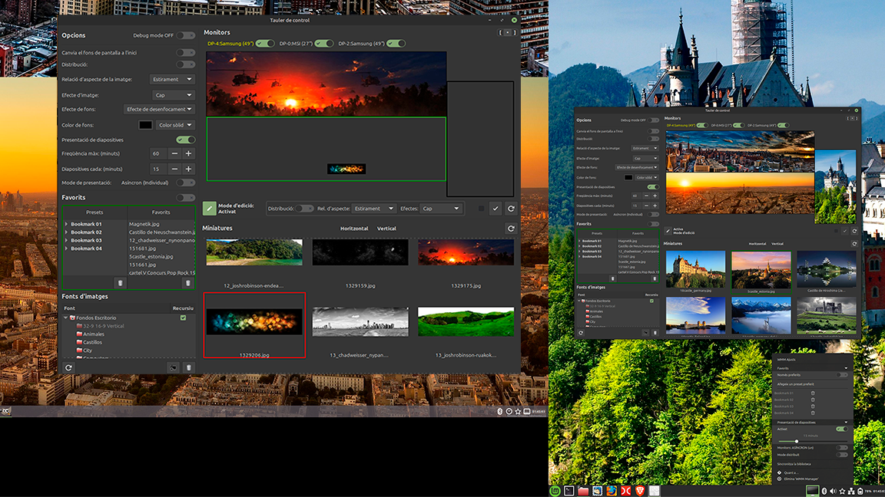

<!--
SPDX-FileCopyrightText: 2026 makimanson
SPDX-License-Identifier: GPL-3.0-or-later
-->

# WMM - Wallpaper Multi-Monitor Manager

Un gestor de fondos de pantalla para configuraciones multi-monitor en **Cinnamon**, **GNOME Shell** y **KDE Plasma 6**.
Olvídate de fondos deformados, recortados o repetidos.
Con WMM, tú tienes el control total.

<p align="center">
  <a href="screenshots/screenshot.png">
    
  </a>
</p>

## ✨ Características principales

*   **Gestión multi-monitor real**: Asigna fondos diferentes a cada monitor o extiende (`Spanned`) una imagen panorámica por todos ellos.
*   **Asignación inteligente de imágenes**: Intenta seleccionar la imagen más apropiada para cada monitor según su orientación vertical u horizontal.
*   **Modos de aspecto flexibles**: Controla cómo se ajusta la imagen: `Scaled` (sin deformar), `Zoom` (llenar recortando) o `Stretched` (llenar deformando).
*   **Efectos visuales**: Aplica filtros `Sepia` o `Blanco y Negro` a las imágenes por monitor.
*   **Efectos de fondo**: Aplica `Desenfoque` o `Color` al fondo cuando la imagen no ocupa toda el área del monitor.
*   **Rotación automática**: Configura un temporizador para cambiar los fondos de forma síncrona (`SYNC`) o asíncrona (`ASYNC`).
*   **Modo Spanned**: Compone una única imagen lógica a través de todos los monitores respetando su posición y geometría.
*   **Favoritos**: Guarda imágenes individuales y combinaciones completas de fondos como Presets para recuperarlas rápidamente.
*   **Panel de control**: Gestiona fuentes, monitores, favoritos, efectos, miniaturas y opciones desde una interfaz común para todos los escritorios soportados.
*   **Integración con el escritorio**: Applet nativo en Cinnamon, extensión en GNOME Shell y plasmoide en KDE Plasma 6.
*   **Internacionalización**: Interfaz disponible en Inglés, Español y Catalán mediante un dominio de traducción propio e independiente del entorno de escritorio.

## 🖥️ Entornos soportados

| Escritorio          | Soporte       | Notas                                      |
|---------------------|---------------|--------------------------------------------|
| **Cinnamon**        | Completo      | Applet nativo. Soporte actual sobre X11    |
| **GNOME Shell**     | Completo      | Extensión nativa. GNOME Shell 45–50        |
| **KDE Plasma 6**    | Completo      | Plasmoide nativo. Requiere Plasma 6        |
| **MATE**            | En desarrollo | Próxima integración                        |
| **XFCE**            | Planeado      | Previsto junto con MATE                    |
| **Windows / macOS** | Planeado      | Soporte futuro                             |

## ⚙️ Integración con el escritorio

WMM adapta la aplicación de los fondos a las capacidades de cada entorno de escritorio.

*   **Cinnamon** y **GNOME Shell** utilizan su integración específica para aplicar la composición generada por WMM.
*   **KDE Plasma 6** aplica los fondos por monitor mediante la API nativa de Plasma, conservando sus transiciones visuales.
*   WMM gestiona automáticamente los ajustes necesarios para su funcionamiento normal; no es necesario preparar manualmente un modo de fondo común para todos los escritorios.

## 🚀 Instalación

1.  Descarga o clona este repositorio en tu ordenador.
2.  Abre una terminal en la carpeta raíz del proyecto.
3.  Ejecuta:

    ```bash
    chmod +x install.sh
    ./install.sh
    ```

El instalador detecta automáticamente **Cinnamon, GNOME Shell o KDE Plasma 6**, comprueba las dependencias necesarias y puede instalar las que falten mediante el gestor de paquetes de la distribución.

Después de la instalación:

*   **Cinnamon**: Reinicia la sesion, abre la configuración de Miniaplicaciones y activa **WMM Manager**, o inicia WMM desde **Menú → Gráficos**.
*   **GNOME Shell**: Reinicia la sesión, abre **Extensiones** y activa **WMM Manager**, o inicia WMM desde **Aplicaciones → WMM**..
*   **KDE Plasma 6**: WMM se iniciará automáticamente en la siguiente sesión de Plasma. También puedes iniciarlo manualmente desde **Menú → Gráficos**.

## 📋 Dependencias

Se recomienda utilizar `install.sh` en lugar de instalar dependencias manualmente. El script comprueba tanto los requisitos comunes como los específicos del escritorio y utiliza los nombres de paquete adecuados para distribuciones basadas en `apt`, `dnf` o `pacman`.

Entre los componentes utilizados por WMM se encuentran:

*   Python 3.
*   Pillow y NumPy para el procesamiento de imágenes.
*   GTK 3, GLib y PyGObject para el panel de control y componentes comunes.
*   `libnotify` para notificaciones.
*   `gettext` para traducciones.
*   `zenity` para determinados diálogos.
*   Herramientas adicionales propias de GNOME o KDE cuando la integración del escritorio las necesita.

La lista mantenida por `install.sh` es la referencia autoritativa para las dependencias de cada plataforma.

## 🗑️ Desinstalación

WMM 1.3.0 todavía no incluye un desinstalador automático.

La instalación se realiza en el perfil del usuario y no modifica archivos del sistema fuera de los mecanismos estándar de instalación de dependencias. La desinstalación completa y la reinstalación controlada se incorporarán en una futura versión.

No se recomienda eliminar automáticamente paquetes instalados como dependencias de WMM, ya que pueden ser utilizados por otras aplicaciones.

## ⌨️ Atajos de teclado

WMM integra la acción de **Siguiente fondo** con los mecanismos de atajos de Cinnamon, GNOME y KDE.

La combinación de teclas puede asignarse o modificarse desde la configuración de atajos del propio escritorio. La acción llama directamente al canal de comandos de WMM; los antiguos scripts `wmm-next.sh` ya no forman parte de la instalación.

## 🛠️ Visor de depuración / Registro de eventos

WMM incluye un sistema de registro integrado que graba en tiempo real la actividad del engine, el panel y las integraciones del escritorio.

*   **Visor integrado**: puede abrirse desde el Panel de Control.
*   **Actualización en tiempo real**: permite filtrar por origen, nivel y motivo, además de buscar texto especifico.
*   **Inspección manual**: el registro se guarda en:

    ```text
    ~/.cache/wmm/debug.log
    ```

El archivo puede abrirse con cualquier editor de texto o consultarse mediante el propio visor de WMM.

## 🌍 Traducción

WMM soporta múltiples idiomas y las traducciones se instalan automáticamente mediante `install.sh`.

*   Los archivos fuente se encuentran en la carpeta `po/` del proyecto.
*   La interfaz utiliza automáticamente el idioma disponible que corresponda a la sesión del usuario. Ingles por defecto si no hay traduccion disponible.
*   Todas las cadenas traducibles utilizan el dominio propio de WMM, independiente de las traducciones del entorno de escritorio y preparado para facilitar futuras integraciones.

Si quieres ayudar a traducir WMM a tu idioma, ¡serás más que bienvenido!

## 📜 Licencia

WMM se distribuye bajo la licencia [GPL-3.0](LICENSE).
Eres libre de usar, modificar y distribuir este software, siempre que mantengas la misma licencia y la atribución a los autores originales.
