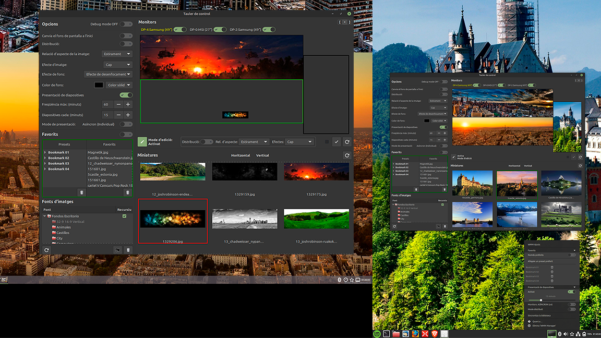

<!--
SPDX-FileCopyrightText: 2026 makimanson
SPDX-License-Identifier: GPL-3.0-or-later
-->

# WMM - Wallpaper Multi-Monitor Manager

A wallpaper manager for multi-monitor setups on **Cinnamon**, **GNOME Shell**, and **KDE Plasma 6**.
No more distorted, cropped, or repeated wallpapers.
With WMM, you stay in full control.

<p align="center">
  <a href="screenshots/screenshot.png">
    
  </a>
</p>

## ✨ Main Features

*   **True multi-monitor management**: Assign different wallpapers to each monitor or stretch (`Spanned`) a panoramic image across all of them.
*   **Smart image selection**: Tries to select the most suitable image for each monitor based on its vertical or horizontal orientation.
*   **Flexible aspect modes**: Control how images are fitted: `Scaled` (no distortion), `Zoom` (fill by cropping), or `Stretched` (fill with distortion).
*   **Visual effects**: Apply `Sepia` or `Black & White` filters to images on a per-monitor basis.
*   **Background effects**: Apply `Blur` or `Color` to the background when the image does not fill the entire monitor area.
*   **Automatic rotation**: Configure a timer to change wallpapers synchronously (`SYNC`) or asynchronously (`ASYNC`).
*   **Spanned Mode**: Compose a single logical image across all monitors while respecting their position and geometry.
*   **Favorites**: Save individual images and complete wallpaper combinations as Presets for quick access.
*   **Control Panel**: Manage sources, monitors, favorites, effects, thumbnails, and options from a common interface across all supported desktops.
*   **Desktop integration**: Native applet for Cinnamon, extension for GNOME Shell, and plasmoid for KDE Plasma 6.
*   **Internationalization**: Interface available in English, Spanish, and Catalan through WMM's own translation domain, independent of the desktop environment.

## 🖥️ Supported Desktop Environments

| Desktop             | Support        | Notes                                      |
|---------------------|----------------|--------------------------------------------|
| **Cinnamon**        | Complete       | Native applet. Current support on X11      |
| **GNOME Shell**     | Complete       | Native extension. GNOME Shell 45–50        |
| **KDE Plasma 6**    | Complete       | Native plasmoid. Requires Plasma 6         |
| **MATE**            | In development | Next integration                           |
| **XFCE**            | Planned        | Planned alongside MATE                     |
| **Windows / macOS** | Planned        | Future support                             |

## ⚙️ Desktop Integration

WMM adapts wallpaper application to the capabilities of each desktop environment.

*   **Cinnamon** and **GNOME Shell** use their own dedicated integration to apply the composition generated by WMM.
*   **KDE Plasma 6** applies wallpapers per monitor through Plasma's native API while preserving its visual transitions.
*   WMM automatically manages the settings required for normal operation; there is no need to manually prepare a common wallpaper mode across all desktops.

## 🚀 Installation

1.  Download or clone this repository to your computer.
2.  Open a terminal in the project's root directory.
3.  Run:

    ```bash
    chmod +x install.sh
    ./install.sh
    ```

The installer automatically detects **Cinnamon, GNOME Shell, or KDE Plasma 6**, checks the required dependencies, and can install any missing ones through your distribution's package manager.

After installation:

*   **Cinnamon**: Restart your session, open the Applets settings and enable **WMM Manager**, or launch WMM from **Menu → Graphics**.
*   **GNOME Shell**: Restart your session, open **Extensions** and enable **WMM Manager**, or launch WMM from **Applications → WMM**.
*   **KDE Plasma 6**: WMM will start automatically in the next Plasma session. You can also launch it manually from **Menu → Graphics**.

## 📋 Dependencies

Using `install.sh` is recommended instead of installing dependencies manually. The script checks both common and desktop-specific requirements and uses the appropriate package names for distributions based on `apt`, `dnf`, or `pacman`.

Components used by WMM include:

*   Python 3.
*   Pillow and NumPy for image processing.
*   GTK 3, GLib, and PyGObject for the Control Panel and common components.
*   `libnotify` for notifications.
*   `gettext` for translations.
*   `zenity` for certain dialogs.
*   Additional GNOME- or KDE-specific tools when required by the desktop integration.

The dependency list maintained by `install.sh` is the authoritative reference for each platform.

## 🗑️ Uninstallation

WMM 1.3.0 does not yet include an automatic uninstaller.

The installation is performed within the user's profile and does not modify system files outside the standard mechanisms used to install dependencies. Complete uninstallation and controlled reinstallation will be added in a future version.

Automatically removing packages installed as WMM dependencies is not recommended, as they may also be used by other applications.

## ⌨️ Keyboard Shortcuts

WMM integrates the **Next Wallpaper** action with the shortcut mechanisms provided by Cinnamon, GNOME, and KDE.

The key combination can be assigned or changed from the desktop environment's own shortcut settings. The action calls WMM's command channel directly; the old `wmm-next.sh` scripts are no longer part of the installation.

## 🛠️ Debug Viewer / Event Log

WMM includes an integrated logging system that records activity from the engine, Control Panel, and desktop integrations in real time.

*   **Integrated viewer**: Can be opened from the Control Panel.
*   **Real-time updates**: Allows filtering by origin, level, and reason, as well as text searches.
*   **Manual inspection**: The log is stored at:

    ```text
    ~/.cache/wmm/debug.log
    ```

The file can be opened with any text editor or inspected through WMM's built-in viewer.

## 🌍 Translation

WMM supports multiple languages, and translations are installed automatically by `install.sh`.

*   Source files are located in the project's `po/` directory.
*   The interface automatically uses the available language matching the user's session. English is used by default when no translation is available.
*   All translatable strings use WMM's own translation domain, independent of desktop-environment translations and designed to support future integrations.

If you would like to help translate WMM into your language, you are more than welcome!

## 📜 License

WMM is distributed under the [GPL-3.0](LICENSE) license.
You are free to use, modify, and distribute this software, provided that you keep the same license and retain attribution to the original authors.
