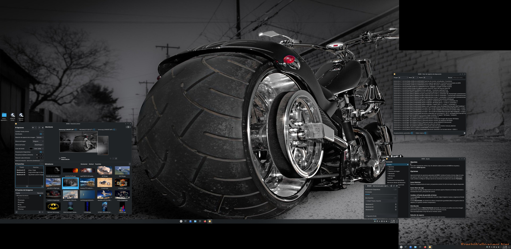

<!--
SPDX-FileCopyrightText: 2026 makimanson
SPDX-License-Identifier: GPL-3.0-or-later

WMM - Wallpaper Multi-Monitor Manager

README_es.md -- Archivo Léame en castellano

WMM-Title: Léame
WMM-Contents: Contenidos
-->

# WMM - Wallpaper Multi-Monitor Manager

Un gestor de fondos de pantalla para configuraciones multi-monitor en **Linux** y **Windows**, compatible con **Cinnamon**, **GNOME Shell**, **KDE Plasma 6**, **MATE** y **XFCE**.

Olvídate de fondos deformados, recortados o repetidos.
Con WMM, tú tienes el control total.

<p align="center">
  <a href="WMM-presentation.jpg">
    
  </a>
</p>

## ✨ Características principales

*   **Gestión multi-monitor real**: Asigna fondos diferentes a cada monitor o extiende (`Spanned`) una imagen panorámica por todos ellos.
*   **Asignación inteligente de imágenes**: Intenta seleccionar la imagen más apropiada para cada monitor según su orientación vertical u horizontal.
*   **Modos de aspecto flexibles**: Controla cómo se ajusta la imagen: `Scaled` (sin deformar), `Zoom` (llenar recortando) o `Stretched` (llenar deformando).
*   **Efectos visuales**: Aplica filtros `Sepia` o `Blanco y Negro` a las imágenes por monitor.
*   **Efectos de fondo**: Aplica `Desenfoque` o `Color` al fondo cuando la imagen no ocupa toda el área del monitor.
*   **Rotación automática**: Configura un temporizador para cambiar los fondos de forma síncrona (`SYNC`) o asíncrona (`ASYNC`).
*   **Rotación selectiva**: Elige qué carpetas de tus fuentes participan en la rotación, con ámbitos independientes para la biblioteca general, la selección y los favoritos.
*   **Modo Spanned**: Compone una única imagen lógica a través de todos los monitores respetando su posición y geometría.
*   **Favoritos**: Guarda imágenes individuales y combinaciones completas de fondos como Presets para recuperarlas rápidamente.
*   **Wallpapers Online**: Busca fondos de pantalla en los proveedores de fondos de pantalla acordados, filtra resultados por orientación y proporciones, y navega entre páginas de resultados.
*   **Edición Online**: Arrastra imágenes de los proveedores directamente a los monitores virtuales para previsualizarlas en el escritorio antes de incorporarlas a tu biblioteca.
*	**Biblioteca de imágenes**: Organiza tus fuentes, consulta miniaturas y mantén sincronizadas tus imágenes mediante el panel de control.
*   **Metadatos de imagen**: Muestra información EXIF/XMP y datos de localización sobre los fondos, con opciones de presentación configurables.
*   **Panel de control**: Gestiona fuentes, monitores, favoritos, efectos, miniaturas y opciones desde una interfaz común para todos los escritorios soportados.
*   **Integración con el escritorio**: Applets nativos en Cinnamon y MATE, extensión en GNOME Shell, plasmoide en KDE Plasma 6, frontend StatusNotifier dedicado en XFCE y aplicación integrada en la bandeja del sistema de Windows.
*   **Integración con los Gestores de archivos nativos**: Al seleccionar una imagen puedes añadirla a favoritos, enviarla a un monitor específico y extenderla a todos ellos.
*   **Gestor de instalación**: Facilita la instalación, actualización, reinstalación y desinstalación de WMM mediante las herramientas correspondientes a cada plataforma.
*   **Internacionalización**: Interfaz disponible en Inglés, Español y Catalán mediante un dominio de traducción propio e independiente del entorno de escritorio.

## 🖥️ Entornos soportados

| Escritorio          | Soporte       | Notas                                      |
|---------------------|---------------|--------------------------------------------|
| **Cinnamon**        | Completo      | Applet nativo. Soporte actual sobre X11    |
| **GNOME Shell**     | Completo      | Extensión nativa. GNOME Shell 45–51        |
| **KDE Plasma 6**    | Completo      | Plasmoide nativo. Requiere Plasma 6        |
| **MATE**            | Completo      | Applet nativo. Soporte actual sobre X11    |
| **XFCE**            | Completo      | Frontend StatusNotifier. XFCE 4.20 / X11   |
| **Windows**         | Completo      | Frontend nativo de bandeja y Explorer      |
| **macOS**           | En desarrollo | Implementación en curso                    |

## ⚙️ Integración con el escritorio

WMM adapta la aplicación de los fondos a las capacidades de cada entorno de escritorio.

*   **Cinnamon** y **GNOME Shell** utilizan su integración específica para aplicar la composición generada por WMM.
*   **KDE Plasma 6** aplica los fondos por monitor mediante la API nativa de Plasma, conservando sus transiciones visuales.
*   **MATE** utiliza su propio backend de fondos y un applet nativo integrado en MATE Panel.
*   **XFCE** utiliza un frontend StatusNotifier dedicado, un backend de fondos mediante `xfconf` y la integración nativa de atajos de XFCE.
*	**Windows** incorpora un icono en la bandeja del sistema, menús de control, integración con el Explorador de archivos, notificaciones, atajos globales y adaptación al tema claro u oscuro.

**WMM** gestiona automáticamente los ajustes necesarios para su funcionamiento normal; no es necesario preparar manualmente un modo de fondo común para todos los escritorios.

## 🚀 Instalación

### Linux

1.  Descarga la última versión disponible en este repositorio en tu ordenador.
2.  Abre una terminal en la carpeta raíz del proyecto.
3.  Ejecuta:
```bash
chmod +x wmm-install.sh
./wmm-install.sh
```

El instalador detecta automáticamente **Cinnamon, GNOME Shell, KDE Plasma 6, MATE o XFCE**, comprueba las dependencias necesarias y puede instalar las que falten mediante el gestor de paquetes de la distribución.

Si detecta una instalación existente, el mismo gestor permite actualizarla, reinstalarla/repararla o desinstalarla.

Después de una instalación nueva:

*   **Cinnamon**: Reinicia la sesión, abre la configuración de Miniaplicaciones y activa **WMM Manager**, o inicia WMM desde **Menú → Gráficos**.
*   **GNOME Shell**: Reinicia la sesión, abre **Extensiones** y activa **WMM Manager**, o inicia WMM desde **Aplicaciones → WMM**.
*   **KDE Plasma 6**: En Plasma 6.6.6 o posterior, el instalador reinicia Plasma Shell sin necesidad de cerrar la sesión. Inicia **WMM Manager** desde **Menú → Gráficos**. Las versiones anteriores de Plasma 6 requieren reiniciar la sesión.
*   **MATE**: Añade **WMM Manager** al panel desde **Añadir al panel**, o inicia WMM desde **Menú → Gráficos**.
*   **XFCE**: Inicia **WMM Manager** desde **Menú → Gráficos**.

### Windows — Open-code

Esta modalidad permite instalar WMM directamente desde su distribución de código abierto.

1. Descarga el código de **WMM** desde **GitHub** y descomprímelo en una carpeta.
2. Ejecuta `wmm-install.cmd` desde la carpeta principal del paquete.
3. El gestor mostrará la versión disponible y las operaciones que puedes realizar.
4. Selecciona **Instalar** y confirma la operación.
5. Si falta el paquete adicional `wmm-runtime.zip`, el instalador ofrecerá descargarlo desde GitHub, siempre que se encuentre disponible.
6. Sigue las indicaciones hasta completar la instalación.

También puedes descargar `wmm-runtime.zip` por separado y colocarlo en la misma carpeta que `wmm-install.cmd` antes de iniciar el instalador.
Una vez instalado, encontrarás WMM Manager en el **menú Inicio de Windows**. También puedes crear un acceso directo en el escritorio y configurar su inicio automático.

El mismo gestor permite actualizar o reinstalar WMM y realizar otras operaciones de mantenimiento cuando estén disponibles.

### Windows — Versión compilada

Esta modalidad proporciona un instalador convencional que ya incluye todos los componentes necesarios.

1. Descarga WMM-Manager-Setup desde la publicación correspondiente.
2. Ejecuta el instalador y sigue las instrucciones del asistente.
3. Elige las opciones de instalación que prefieras.
4. Una vez finalizado el proceso, inicia WMM Manager desde el menú Inicio o mediante su acceso directo.

No es necesario descargar Python, GTK ni ningún paquete adicional.
Si ya tienes instalada una versión anterior de esta modalidad, puedes utilizar el nuevo instalador para actualizarla.

## 📋 Dependencias

### Linux

Se recomienda utilizar `wmm-install.sh` en lugar de instalar dependencias manualmente. El script comprueba tanto los requisitos comunes como los específicos del escritorio y utiliza los nombres de paquete adecuados para distribuciones basadas en `apt`, `dnf` o `pacman`.

Entre los componentes utilizados por WMM se encuentran:

*   Python 3.
*   Pillow y NumPy para el procesamiento de imágenes.
*   GTK 3, GLib y PyGObject para el panel de control y componentes comunes.
*   **VTE 2.91** para el terminal incrustado del Gestor de instalación.
*   `libnotify` para notificaciones.
*   `gettext` para traducciones.
*   Herramientas adicionales propias de GNOME, KDE, MATE o XFCE cuando la integración del escritorio las necesita.

La lista mantenida por `wmm-install.sh` es la referencia autoritativa para las dependencias de cada plataforma.

### Windows — Open-code

Esta modalidad necesita el paquete adicional `wmm-runtime.zip`, que contiene los componentes necesarios para ejecutar WMM en Windows.

Puedes obtenerlo de dos maneras:

*	Descargándolo desde GitHub y colocándolo junto a `wmm-install.cmd`.
*	Aceptando su descarga desde el gestor de instalación cuando este lo ofrezca.

El runtime se distribuye por separado del código de WMM, por lo que no es necesario volver a descargarlo con cada actualización si continúa siendo compatible.

### Windows — Versión compilada

El instalador WMM-Manager-Setup ya incorpora todas las dependencias necesarias. No requiere instalaciones adicionales.

## 🗑️ Desinstalación

### Linux

**WMM** puede desinstalarse desde **Install Manager** o ejecutando directamente el desinstalador incluido:

```bash
chmod +x wmm-uninstall.sh
./wmm-uninstall.sh
```

También puede seleccionarse **Desinstalar** al ejecutar `wmm-install.sh` sobre una instalación existente.

El desinstalador elimina WMM y sus integraciones de escritorio, pero no elimina automáticamente paquetes instalados como dependencias, ya que pueden ser utilizados por otras aplicaciones.

### Windows — Open-code

1. Abre **WMM Install Manager** desde el menú Inicio o ejecuta `wmm-install.cmd` desde la distribución de código.
2. Selecciona **Desinstalar**.
3. Confirma la operación.

Esta desinstalación elimina WMM, sus integraciones con Windows, la configuración y la caché de la aplicación.

### Windows — Versión compilada

1. Abre Aplicaciones instaladas de Windows o utiliza el desinstalador de WMM disponible en el menú Inicio.
2. Selecciona **Desinstalar** y sigue las indicaciones.
3. Elige si deseas conservar o eliminar la configuración y la caché de miniaturas.

## ⌨️ Atajos de teclado

WMM permite asignar una combinación de teclas a la acción Siguiente fondo, para cambiar el fondo de pantalla sin abrir el panel de control.

*	Linux: Configura la combinación desde los ajustes de atajos del escritorio.
*	Windows: Configura el atajo global desde las opciones de WMM.

Puedes modificar la combinación según tus preferencias.

## 🛠️ Visor de depuración / Registro de eventos

WMM incluye un sistema de registro integrado que muestra en tiempo real la actividad del engine, el panel y las integraciones del escritorio.

*   **Visor integrado**: puede abrirse desde el Panel de Control.
*   **Actualización en tiempo real**: permite filtrar por origen, nivel y motivo, además de buscar texto específico.
*   **Inspección manual**: También puedes abrir el archivo de registro con un editor de texto.

Ubicación del registro en Linux:
```text
~/.cache/wmm/debug.log
```

Ubicación del registro en Windows:
```text
%LOCALAPPDATA%\WMM Manager\cache\debug.log
```

Este registro puede resultar útil para identificar incidencias y facilitar su diagnóstico.

## 🌍 Traducción

WMM está disponible en inglés, español y catalán, y selecciona automáticamente el idioma correspondiente a la sesión del usuario cuando existe una traducción disponible.
El inglés se utiliza como idioma predeterminado cuando no se dispone de una traducción.

Los archivos de traducción del proyecto se encuentran en:
```text
wmm_platform/shell/po/
```
Si quieres ayudar a traducir WMM a tu idioma, ¡serás más que bienvenido!

## 📜 Licencia

WMM se distribuye bajo la licencia [GPL-3.0](../LICENSE).
Eres libre de usar, modificar y distribuir este software, siempre que mantengas la misma licencia y la atribución a los autores originales.

## 🤝 Agradecimientos y colaboraciones

**WMM** agradece a los siguientes proveedores de fondos de pantalla la disponibilidad de sus servicios y contenidos, que permiten ampliar las fuentes de imágenes del proyecto.

Sus logotipos enlazan directamente a sus sitios web, y cada imagen conserva un enlace a su ficha original, incluso desde la biblioteca local.

<p align="left">
  <a href="https://wallhaven.cc/">
    
  </a>
&emsp;&emsp;
  <a href="https://alphacoders.com/">
    
  </a>
</p>

### Datos geográficos

**WMM** agradece a **dr5hn y a los colaboradores de Countries States Cities Database** su trabajo en la recopilación y mantenimiento de los datos geográficos utilizados por el proyecto.

**Fuente:** [Countries States Cities Database](https://github.com/dr5hn/countries-states-cities-database)\
**Licencia de los datos:** [Open Database License (ODbL) v1.0](https://github.com/dr5hn/countries-states-cities-database/blob/master/LICENSE)

### Instalador de Windows

**WMM** agradece a **Jordan Russell y Martijn Laan** el desarrollo y mantenimiento de **Inno Setup**, la herramienta utilizada para crear el instalador de la versión compilada de Windows.

**Herramienta:** [Inno Setup](https://jrsoftware.org/isinfo.php)\
**Licencia:** [Inno Setup License](https://github.com/jrsoftware/issrc/blob/main/license.txt)
